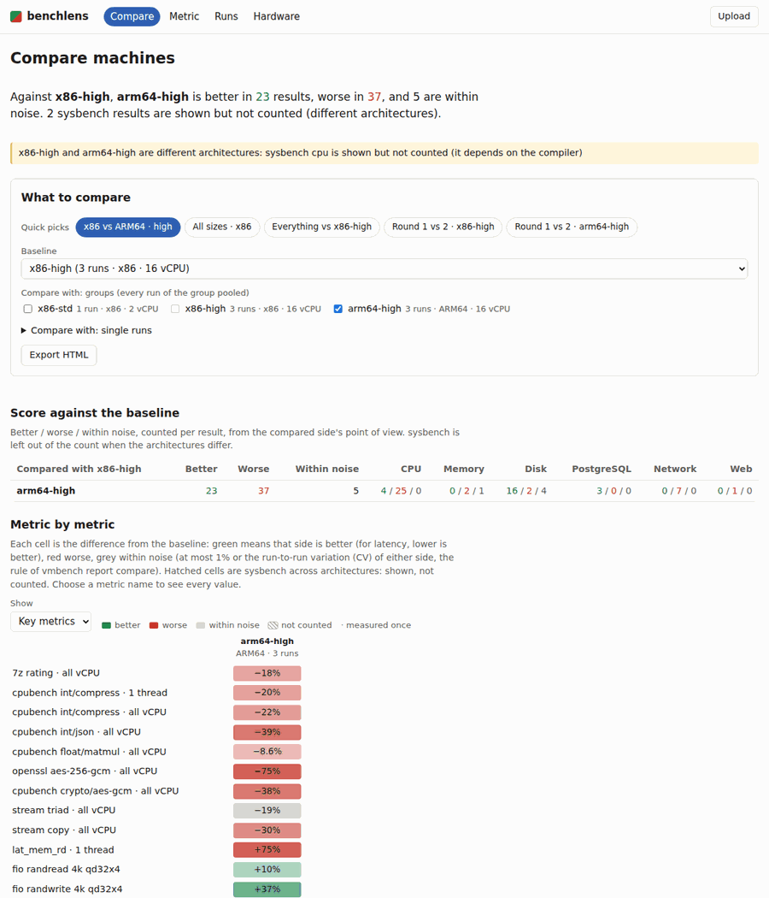

# benchlens

Look at, compare and share [vmbench](https://github.com/chaloemph/vmbench) results.

benchlens imports vmbench result folders into a SQLite file and compares machines metric by metric with
**the same rule as `vmbench report compare`**, so its "better / worse / within noise" always agrees with
vmbench's own reports. Compare one run with another, or pool repeated runs of a machine as one group. One
binary: command line, web UI and JSON API, an inbox folder, upload with token auth, and an HTML export that
opens offline.

> Status: v0.1.0, the first public release: import (CLI, registry, inbox, upload), compare (CLI, web UI,
> API), static HTML / JSON / CSV export, Docker image. See [CHANGELOG.md](CHANGELOG.md) and
> [docs/plan.md](docs/plan.md).



## Quick start

With [benchlens installed](#install), from a clone of this repository (the example data is real, from a POC
of x86 and ARM64 VMs):

```bash
benchlens import --registry examples/poc-2026-11/registry.tsv tests/fixtures/v0.2.1 tests/fixtures/v0.2.3
benchlens compare group:x86-high group:arm64-high      # 16-vCPU x86 VM against 16-vCPU ARM64 VM
benchlens serve                                        # web UI on http://127.0.0.1:8080
benchlens export html --base group:x86-high --other group:arm64-high -o report.html   # share it
```

```text
baseline: x86-high (3 runs)

== arm64-high vs x86-high: better 23, worse 37, within noise 5
   by section (better/worse/within noise): cpu 4/25/0  disk 16/2/4  mem 0/2/1  net 0/7/0  pg 3/0/0  web 0/1/0
...
```

Your own results: `benchlens import ~/bench-results/` (result folders, a folder of them, or `.tar.gz`).
Output piped into a reader that stops early (`benchlens compare ... | head`) ends the command quietly, killed
by SIGPIPE like other Unix tools (the shell reports status 141; with `set -o pipefail` that counts as a failure).

## Documentation

| | |
|---|---|
| [Walkthrough](docs/walkthrough.md) | from clone to a comparison with the example data, step by step, with screenshots |
| [User guide](docs/guide.md) | runs, groups, tags and references; every import route; compare; export; running on a server; Docker; upgrading |
| [HTTP API](docs/api.md) | every endpoint, parameter and JSON shape, with real examples |
| [Data contract](docs/contract.md) | the files benchlens reads from vmbench, the metric tables, the verdict rule and its golden tests |
| [CONTRIBUTING](CONTRIBUTING.md) | development setup, layout, ground rules, adding a vmbench version, tests |
| [SECURITY](SECURITY.md) | supported versions, reporting a vulnerability, the security model |
| [CHANGELOG](CHANGELOG.md) | what is in each release |

## Install

benchlens is one binary with the web UI built in; the only state is the SQLite file.

### From a release

Download the archive for your platform and `SHA256SUMS` from
[Releases](https://github.com/chaloemph/benchlens/releases). Targets: `x86_64-unknown-linux-musl`,
`aarch64-unknown-linux-musl` (static, any distro), `aarch64-apple-darwin`, `x86_64-apple-darwin`,
`x86_64-pc-windows-msvc` (zip).

```bash
VERSION=0.1.0 TARGET=x86_64-unknown-linux-musl
curl -LO https://github.com/chaloemph/benchlens/releases/download/v$VERSION/benchlens-$VERSION-$TARGET.tar.gz
curl -LO https://github.com/chaloemph/benchlens/releases/download/v$VERSION/SHA256SUMS
sha256sum --check --ignore-missing SHA256SUMS     # macOS: shasum -a 256 --check --ignore-missing SHA256SUMS
tar -xzf benchlens-$VERSION-$TARGET.tar.gz
install -m 0755 benchlens-$VERSION-$TARGET/benchlens ~/.local/bin/
```

On Windows: `Get-FileHash benchlens-<version>-x86_64-pc-windows-msvc.zip` and compare with `SHA256SUMS`.

### From source

Rust 1.89 or later (and a C compiler, for the bundled SQLite):

```bash
cargo install --path crates/cli
```

### Docker

The image (`ghcr.io/chaloemph/benchlens`, linux/amd64 and linux/arm64) runs `benchlens serve` as a
non-root user on port 8080 with the database at `/data/benchlens.db`:

```bash
docker run -d --name benchlens -p 8080:8080 -v benchlens-data:/data \
  -e BENCHLENS_TOKEN="$(openssl rand -hex 32)" ghcr.io/chaloemph/benchlens
# import: make the results readable in the container, then run the same image with another command
docker run --rm -v benchlens-data:/data -v "$PWD/results:/results:ro" ghcr.io/chaloemph/benchlens import /results
```

The container listens on `0.0.0.0`, which is not loopback: **without `BENCHLENS_TOKEN` it is read-only**
(upload, tag editing and delete answer 403; reading, the web UI and `import` through `docker run` still work).
With a token, the web UI asks for it once per tab. See [Running on a server](#running-on-a-server).
`docker stop` stops it cleanly (SIGTERM).

Or with Compose, from a checkout ([docker-compose.yml](docker-compose.yml)):

```bash
BENCHLENS_TOKEN=$(openssl rand -hex 32) docker compose up -d     # http://localhost:8080
docker compose build                 # build the image locally instead of pulling it
```

### Grafana

The compose profile `grafana` adds Grafana (port 3000 on 127.0.0.1, anonymous viewers) with the benchlens database mounted
read-only and three dashboards: a metric over time per group, group vs group (mean, min, max, n), and the runs
with tags, vmbench version and failed stages.

```bash
BENCHLENS_TOKEN=$(openssl rand -hex 32) GRAFANA_ADMIN_PASSWORD=change-me docker compose --profile grafana up -d
```

Grafana shows means and ranges (SQLite has no median); verdicts (better / worse / within noise) are decided
by benchlens only. Grafana reads the live database (SQLite WAL on a read-only mount), also while benchlens is
stopped. The defaults (admin password `admin`, anonymous viewers, port on 127.0.0.1) are for a local machine;
on a server set `GRAFANA_ADMIN_PASSWORD`, consider `GRAFANA_ANONYMOUS=false`, then publish the port with
`GRAFANA_BIND=0.0.0.0`. Details, versions and limits: [deploy/grafana/README.md](deploy/grafana/README.md).

## Running on a server

`benchlens serve` reads its settings from flags, then `BENCHLENS_*` variables, then an optional
`benchlens.toml` (`--config FILE` / `BENCHLENS_CONFIG`, else `./benchlens.toml` when present):

```toml
db = "/data/benchlens.db"
listen = "0.0.0.0:8080"
token = "..."            # or BENCHLENS_TOKEN; at least 16 characters, e.g. `openssl rand -hex 32`
read_public = true       # false: reading needs the token too (the page still loads and asks for it)
max_upload_mb = 256      # largest archive accepted by upload
# allowed_hosts = ["bench.example.com"]   # or BENCHLENS_ALLOWED_HOSTS=a,b: Host names served (see below)
# registry = "/data/registry.tsv"   # tags for inbox imports and uploads (old name: inbox_registry)
# inbox = "/data/inbox"  # optional, with inbox_interval = 5
# inbox_tags = { set = "poc" }
```

- **Token**: with a token, uploading, tag editing and delete need it (`Authorization: Bearer <token>`; the
  web UI asks once per tab). Without a token, writes are open only on a loopback address; on `0.0.0.0` or
  any other address they are refused and the server warns at start. The Docker image listens on
  `0.0.0.0:8080`, so pass `-e BENCHLENS_TOKEN=...` to upload or edit through it. There is no `--token` flag
  (command lines are visible to other users); the token is never printed.
- **read_public = false** keeps the data private: every `/api` call except `/api/health` needs the token.
  The server refuses to start like that without a token.
- **Host names** (DNS rebinding guard): without a token, the server answers only requests addressed to
  `localhost` or an IP address (`127.0.0.1`, `[::1]`, `192.168.1.5`, any port); any other `Host` gets 403.
  This stops a web page whose domain is re-pointed at 127.0.0.1 from reading or writing a local server. To
  reach a token-less server by a name (`http://bench.lan:8080`), list it in `allowed_hosts` /
  `BENCHLENS_ALLOWED_HOSTS`. With a token every name is served, unless `allowed_hosts` is set, which then
  limits the names in the same way.
- **Upload**: the Upload button in the web UI, or
  `curl -H "Authorization: Bearer $TOKEN" -F file=@results.tar.gz -F tag=round=2 http://host:8080/api/runs`.
  The server's `registry`, when set, tags uploaded runs too (tags of the upload win over it).
- **Reverse proxy**: benchlens speaks plain HTTP; put TLS in front (Caddy, nginx) so the token is not sent in
  the clear, and set a token even when benchlens itself listens on 127.0.0.1 behind the proxy: the proxy makes
  it reachable from outside, and without a token loopback means "writes open". As a safety net, a token-less
  server refuses writes (403) that carry `Forwarded`, `X-Forwarded-For` or `X-Forwarded-Host`, which proxies
  add; a proxy that sends none of them is not detected, so the token is still needed. With a token, pass the
  proxy's public name in `allowed_hosts` if you like, or keep the original `Host` (nginx: `proxy_set_header
  Host $host`). Allow request bodies of at least `max_upload_mb` in the proxy (nginx: `client_max_body_size`).

Details: [docs/api.md](docs/api.md#auth).

## For other tools

The database has three views: `v_runs` (runs with their group), `v_values` (every value that counts, with its
metric name, unit and direction) and `v_stats` (count, mean, min, max per run and metric); see
[the guide](docs/guide.md#reading-the-database-from-other-tools). SQLite has no median, so verdicts come from
benchlens itself. Ready-made Grafana dashboards on these views: [Grafana](#grafana).

## Example data

`tests/fixtures/` and `examples/poc-2026-11/` are real results from a POC of x86 and ARM64 VMs (vmbench
v0.2.1 and v0.2.3). vmbench's hardware.json carries no serial numbers, host names or addresses.

## License

Apache-2.0
