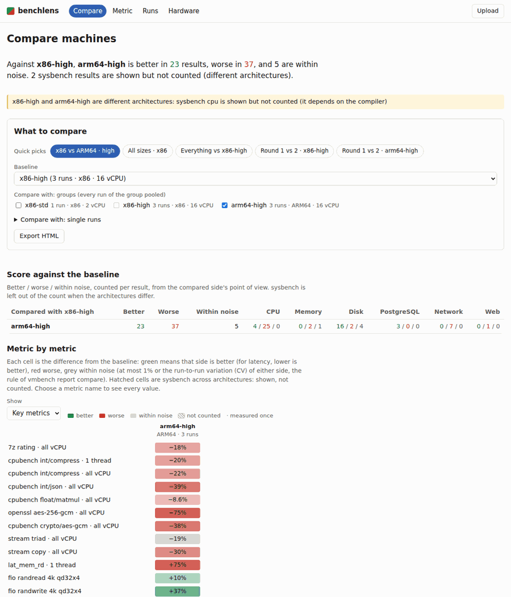
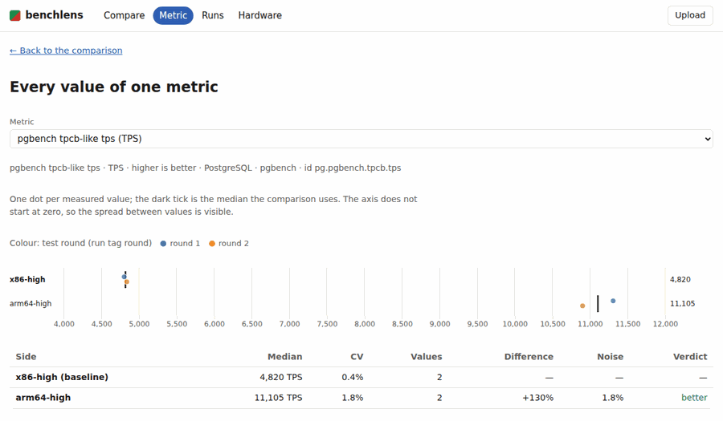

# Walkthrough: from clone to a comparison

Ten minutes, most of them compiling. You will import real vmbench results from a POC, compare an x86 VM with
an ARM64 VM on the command line and in the browser, and export the comparison as one HTML file. Every command
was run in a fresh clone and the output is pasted as printed (cut where marked `...`).

You need git and either a [release binary](../README.md#from-a-release) or Rust 1.89+ with a C compiler.

## 1. Get the code and the binary

```bash
git clone https://github.com/chaloemph/benchlens
cd benchlens
cargo install --path crates/cli          # or put a release binary on your PATH
```

```text
$ benchlens --version
benchlens 0.1.2
```

## 2. The example data

The POC tested six Proxmox VMs: x86 and ARM64, each at three sizes (`std` 2 vCPU, `med` 8 vCPU, `high`
16 vCPU), in two test rounds. Seven of its result folders are in the repository:

```text
tests/fixtures/v0.2.1/arm64-high-20261118-203447       round 1, vmbench 0.2.1
tests/fixtures/v0.2.1/x86-high-20261119-033546         round 1, vmbench 0.2.1
tests/fixtures/v0.2.3/arm64-high-web-20261119-030942   round 1, rerun of the web stage
tests/fixtures/v0.2.3/x86-high-web-20261119-101442     round 1, rerun of the web stage
tests/fixtures/v0.2.3/arm64-high-r2-20261119-074530    round 2
tests/fixtures/v0.2.3/x86-high-r2-20261119-145026      round 2
tests/fixtures/v0.2.3/x86-std-r2-20261119-103253       round 2, the small x86 VM
```

Each holds what vmbench writes: `meta.json` (label, architecture, vCPU, RAM, stages), `results.tsv` (every
measured value), `status.tsv` (which stages passed) and `hardware.json`. In round 1 the web stage pinned its
load generator to CPUs the VMs did not have, so it was rerun on its own (`*-web-*`).

[examples/poc-2026-11/registry.tsv](../examples/poc-2026-11/registry.tsv) describes all 18 runs of the POC,
one row per result folder, one column per tag:

```text
run	group	set	size	round	host	exclude	note
x86-std-20261118-233315	x86-std	poc-x86	std	1	proxmox	web	web failed (CPU pinning), rerun in x86-std-web
...
```

It puts each run in its machine's group (`x86-high` gets x86-high, x86-high-web and x86-high-r2), records
the test round, and sets `exclude=web` on the round-1 full runs, so their broken web values are left out
and the reruns' values count instead.

## 3. Import

```text
$ benchlens import --registry examples/poc-2026-11/registry.tsv tests/fixtures/v0.2.1 tests/fixtures/v0.2.3
imported  a96af04543575da1  arm64-high-20261118-203447  141 values, vmbench v0.2.1
imported  180fba1956b130d0  x86-high-20261119-033546  141 values, vmbench v0.2.1
imported  970595d84a8ab297  arm64-high-r2-20261119-074530  141 values, vmbench v0.2.3
imported  d95fc3263e8efb18  arm64-high-web-20261119-030942  5 values, vmbench v0.2.3
imported  d6422680ad835889  x86-high-r2-20261119-145026  141 values, vmbench v0.2.3
imported  74cbd13504ee0072  x86-high-web-20261119-101442  5 values, vmbench v0.2.3
imported  7969870900abc86d  x86-std-r2-20261119-103253  141 values, vmbench v0.2.3
7 imported, 0 already present, 0 would import, 0 failed, 0 refused
```

The database is `benchlens.db` in the current folder (`--db` or `BENCHLENS_DB` to change it). Running the
command again imports nothing twice.

```text
$ benchlens runs
RUN               LABEL                         ARCH      vCPU  VMBENCH  GROUP / TAGS
a96af04543575da1  arm64-high                    aarch64     16  v0.2.1   arm64-high  exclude=web host=proxmox note=web used 8 CPUs only, rerun round=1 set=poc-arm64 size=high
180fba1956b130d0  x86-high                      x86_64      16  v0.2.1   x86-high  exclude=web host=proxmox note=web used 8 CPUs only, rerun in x86-high-web round=1 set=poc-x86 size=high
d95fc3263e8efb18  arm64-high-web                aarch64     16  v0.2.3   arm64-high  host=proxmox note=web rerun v0.2.3 round=1 set=poc-arm64 size=high
74cbd13504ee0072  x86-high-web                  x86_64      16  v0.2.3   x86-high  host=proxmox note=web rerun v0.2.3 round=1 set=poc-x86 size=high
7969870900abc86d  x86-std-r2                    x86_64       2  v0.2.3   x86-std  host=proxmox round=2 set=poc-x86 size=std
970595d84a8ab297  arm64-high-r2                 aarch64     16  v0.2.3   arm64-high  host=proxmox round=2 set=poc-arm64 size=high
d6422680ad835889  x86-high-r2                   x86_64      16  v0.2.3   x86-high  host=proxmox round=2 set=poc-x86 size=high
```

## 4. Compare on the command line

Is the 16-vCPU ARM64 VM faster than the 16-vCPU x86 VM? Compare the two groups; each pools its three runs:

```text
$ benchlens compare group:x86-high group:arm64-high --section disk
baseline: x86-high (3 runs)

== arm64-high vs x86-high: better 23, worse 37, within noise 5
   by section (better/worse/within noise): cpu 4/25/0  disk 16/2/4  mem 0/2/1  net 0/7/0  pg 3/0/0  web 0/1/0
   metric                                           x86-high   arm64-high     diff  verdict
   fio randread 8k ↑ (IOPS)                          116,518      132,377   +13.6%  better
   fio randrw 70/30 8k read ↑ (IOPS)                  72,981       82,488   +13.0%  better
   fio randrw 70/30 8k write ↑ (IOPS)                 31,254       35,329   +13.0%  better
   fio randwrite 8k ↑ (IOPS)                          82,301      105,405   +28.1%  better
   fio seqwrite 1M ↑ (MB/s)                            1,208        3,610  +198.7%  better !
...
   fio randread 4k qd1 p99 ↓ (us)                        446          362   -18.9%  within noise !
   fio randread 4k qd1 p99.9 ↓ (us)                      919        1,439   +56.6%  within noise !
...
   wal commit iops qd1 ↑ (IOPS)                        1,056        3,752  +255.4%  better
   wal fdatasync avg ↓ (ms)                            0.938        0.257   -72.6%  better
   wal fdatasync p99 ↓ (ms)                            2.212        0.590   -73.3%  better !

↑ higher is better, ↓ lower is better; * measured once (noise unknown); ! CV of 5% or more
note: x86-high and arm64-high are different architectures: sysbench cpu is shown but not counted (it depends on the compiler)
```

How to read it:

- The headline counts every metric: ARM64 is better in 23, worse in 37, and within noise in 5. Per section,
  it wins on disk (16/2/4) and PostgreSQL (3/0/0) and loses on CPU (4/25/0) and network (0/7/0).
- `diff` is (ARM64 − x86) / x86 of the medians; `↓` marks metrics where lower is better, so −72.6 % latency
  is "better".
- "within noise" means the difference is not larger than the run-to-run variation (CV) of either side, or
  1 %. fio p99 latency moved 19 % and 57 %, but those metrics vary by more than that between runs (`!`), so
  the rule does not call them. This is the rule of `vmbench report compare`; benchlens's tests check it
  against vmbench's own verdicts.
- sysbench cpu is shown but not counted across architectures: its numbers depend on the compiler.

Drop `--section` to see all sections. Other questions the same data answers:

```text
$ benchlens compare group:arm64-high@round=1 group:arm64-high@round=2 | sed -n 1,4p
baseline: arm64-high · round=1 (2 runs)

== arm64-high · round=2 vs arm64-high · round=1: better 14, worse 23, within noise 30
   by section (better/worse/within noise): cpu 5/2/24  disk 5/13/4  mem 0/3/0  net 4/3/0  pg 0/2/1  web 0/0/1
```

`group:arm64-high@round=1` is the part of the group whose `round` tag is 1: did the same VM behave the same
in both rounds? Mostly within noise on CPU, but its disk results moved. A single run works as a side too,
by label, folder or id prefix: `benchlens compare x86-std-r2 x86-high-r2`.

## 5. The web UI

```text
$ benchlens serve --listen 127.0.0.1:8091
benchlens 0.1.2 on http://127.0.0.1:8091 (database benchlens.db)
reads open; writes open (loopback, no token); uploads up to 256 MiB
Host names served: localhost, IP addresses
```

(Without `--listen` it uses `127.0.0.1:8080`. Without a token the server answers only `localhost` and IP
addresses, a guard against DNS rebinding; see the [user guide](guide.md#who-may-read-and-write).) Open the address in a browser. The Compare view starts with
the quick pick "x86 vs ARM64 · high", the same comparison as above: the takeaway sentence, the tally per
section and a heatmap of the key metrics (choose "Show" for every metric or one section).



Choose a metric name in the heatmap to see every value behind it. Here pgbench TPS: each dot is one measured
value, coloured by test round, and the dark tick is the median the comparison uses. The two x86 runs
agree closely; the two ARM64 runs differ more, and the difference is still far beyond that noise, so
"better".



The Runs view lists the seven runs with their tags (editable), and the Hardware view puts the
`hardware.json` of chosen runs side by side. Every page is a link you can share: the URL holds the
selection, for example
`http://127.0.0.1:8091/?view=compare&base=group:x86-high&other=group:arm64-high&section=key`.

Stop the server with Ctrl-C.

## 6. Share it

```text
$ benchlens export html --base group:x86-high --other group:arm64-high --other group:x86-std -o poc-high.html
wrote poc-high.html (786 KB): 3 sides, 7 runs, 709 values
```

Send `poc-high.html` to anyone: it opens from disk in a browser with no server and no network, shows the
same views, and lets the reader change the baseline or compare single runs of the exported groups, with the
verdicts computed by the same rule. `benchlens export csv` and `export json` give the raw values for a
spreadsheet or a script ([guide](guide.md#exporting)).

## 7. Your own results

Run vmbench on your machines, then import the result folders or archives (the paths here stand for yours;
the same commands on the fixtures are in the [guide](guide.md#importing)):

```bash
benchlens import ~/bench-results/                              # a folder of result folders
benchlens import my-vm-20261120-101500.tar.gz --tag round=1     # an archive, with a tag
```

Without a registry each run lands in an automatic group (its label without `-r2` / `-web` suffixes, plus CPU,
vCPU and RAM); a `group` tag puts runs where you want them. For a team, run `benchlens serve` on a server with
a token and let people upload, or point an inbox folder at it: see the [user guide](guide.md).
